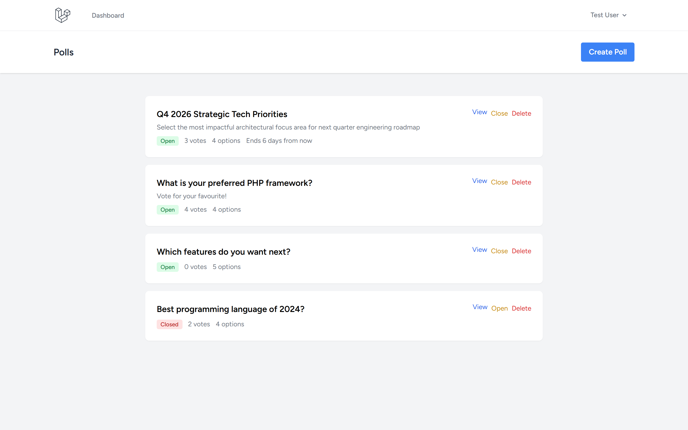
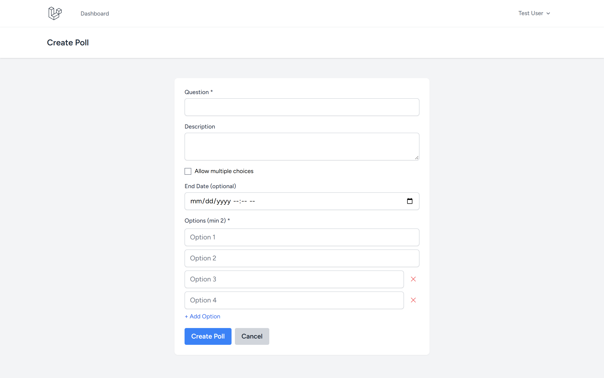
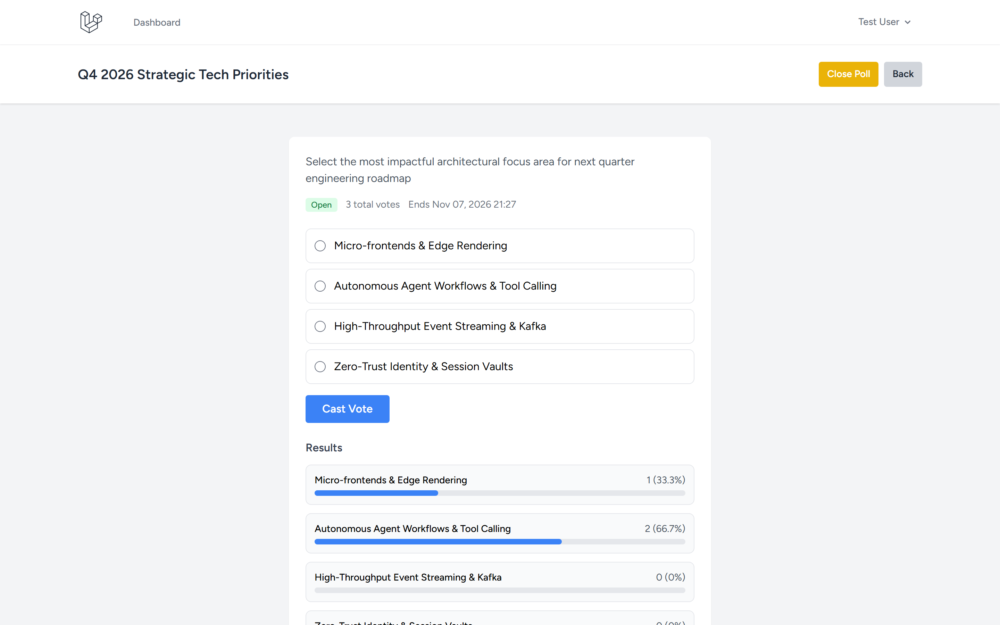
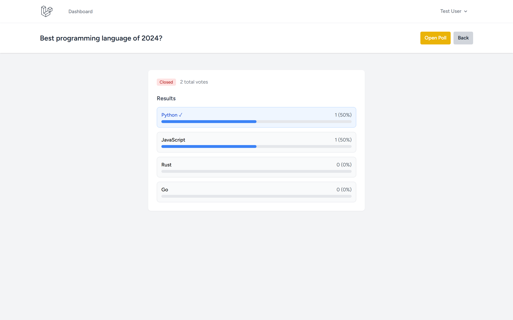

# Simple Voting App

Repository: https://github.com/0xyz-exe/simple-voting-app-laravel

## Screenshots

| Tampilan | Preview |
|---|---|
| **Daftar Jajak Pendapat & Status Voting**<br>Tampilan antarmuka utama polling dengan ringkasan pertanyaan, badge status (Open/Closed), total suara pemilih, jumlah opsi pilihan, dan kontrol pembukaan/penutupan voting |  |
| **Formulir Pembuatan Jajak Pendapat Baru**<br>Formulir pembuatan polling interaktif dengan input pertanyaan, deskripsi latar belakang, opsi multi-choice, batas waktu voting, dan manajemen input opsi dinamis |  |
| **Formulir Voting Interaktif & Hasil Persentase Suara**<br>Halaman detail polling aktif dengan formulir pemilihan opsi suara, tombol submit Cast Vote, dan visualisasi bar hasil perolehan suara secara real-time |  |
| **Rekapitulasi Hasil Polling Tertutup (Final Breakdown)**<br>Halaman hasil voting tertutup menampilkan indikator tanda centang (✓) opsi yang dipilih pengguna, persentase akhir suara, dan kontrol pembukaan ulang |  |

## Features

- ✅ Auth (Laravel Breeze)
- ✅ Create polls with 2-10 options
- ✅ Single or multiple-choice voting
- ✅ Live results with progress bars & percentages
- ✅ Open/close polls
- ✅ Optional end date/time
- ✅ One vote per user (duplicate prevention)

## Tech Stack

Laravel 13.38.0 · Breeze 2.4 · SQLite · Tailwind CSS

## Installation

```bash
git clone https://github.com/0xyz-exe/simple-voting-app-laravel.git
cd simple-voting-app-laravel
composer install && npm install && npm run build
cp .env.example .env && php artisan key:generate
touch database/database.sqlite
php artisan migrate --seed
php artisan serve
```

**Demo:** test@example.com / password — 3 seeded polls (2 open, 1 closed)

## Schema

**polls**: id, user_id, question, description, is_active, allow_multiple, ends_at, timestamps  
**poll_options**: id, poll_id, option_text, timestamps  
**votes**: id, user_id, poll_id, poll_option_id, timestamps

## License

MIT
